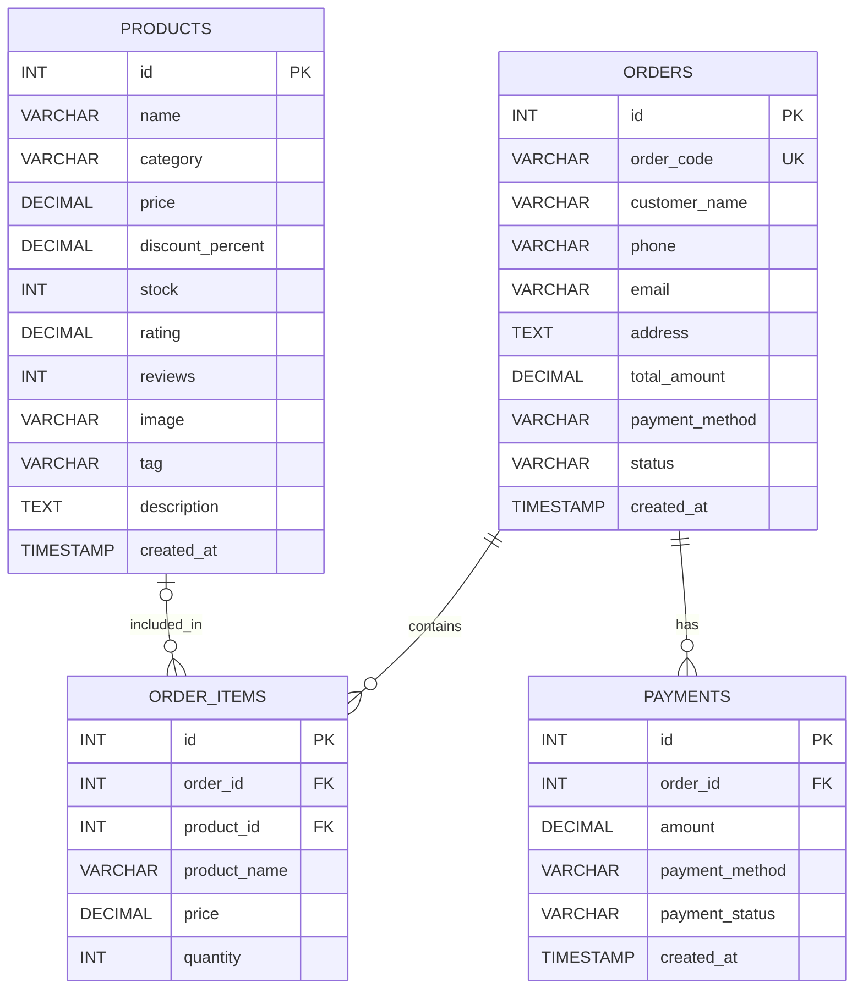

# ShopEasy – Entity Relationship Diagram (ERD)

## Relationship Description

| Relationship | Description |
|---|---|
| ORDERS – ORDER_ITEMS | One order can contain multiple order items. |
| PRODUCTS – ORDER_ITEMS | One product can appear in multiple order items. A product reference can be NULL. |
| ORDERS – PAYMENTS | One order can have multiple payment records. |

## Notes

- PK: Primary Key.
- FK: Foreign Key.
- UK: Unique Key.
- The database uses MySQL with InnoDB and utf8mb4.
- Product discounts are stored in `discount_percent`.
- The `order_items.price` field stores the product price used when the order is created.
